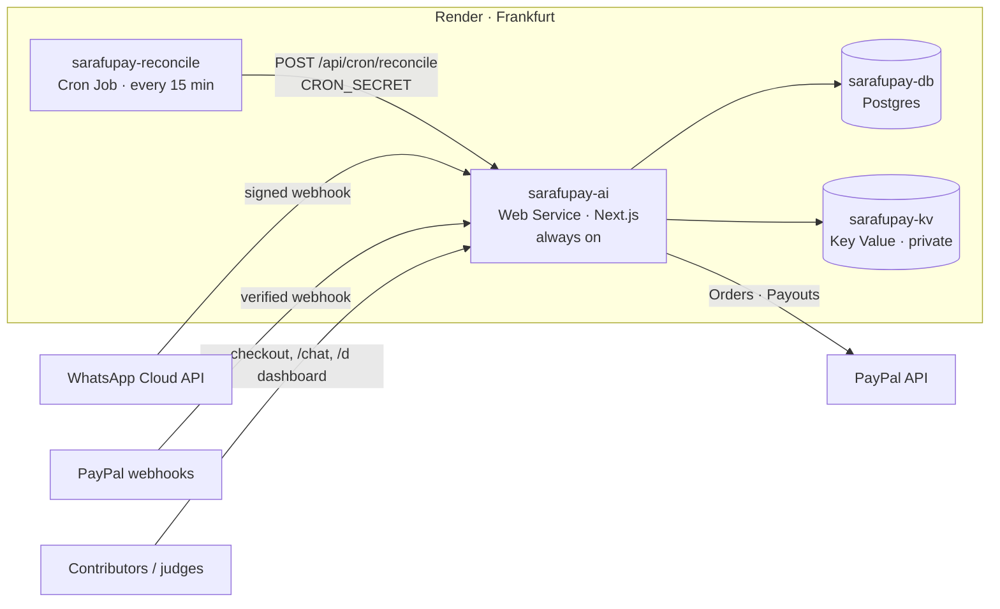

<p align="center">
  
</p>

<h1 align="center">SarafuPay</h1>

<p align="center"><b>Michango, without the notebook.</b><br/>
An AI agent inside WhatsApp that runs group collections with <b>PayPal</b> and pays out in the open.</p>

<p align="center">
  <a href="https://sarafupay-ai.onrender.com">Live app</a> ·
  <a href="https://sarafupay-ai.onrender.com/chat">WhatsApp simulator</a> ·
  <a href="https://wa.me/255650972587">Chat on WhatsApp</a> ·
  <a href="docs/DEVPOST.md">Devpost write-up</a>
</p>

Built for the [PayPal AI Hackathon 2026](https://paypalaihackathon.devpost.com). All money movement runs on the **PayPal sandbox** (test money only).

---

## Try it now

| Option | How |
|---|---|
| **Real WhatsApp** | Message **+255 650 972 587** (display name *SarafuPay*), e.g. `Hi, I want to collect $300 for a wedding` |
| **Web simulator** (no phone needed) | Open [`/chat`](https://sarafupay-ai.onrender.com/chat). Same agent, same PayPal sandbox. Every browser gets its **own private session** with its own test numbers, so you start clean and never see another judge's chats. Switch between Organiser and friends, or add your own test people |
| **Pay as a friend** | Use the pay link the bot sends, or the public page `/c/CODE`, and log in with a PayPal sandbox **personal** account (credentials are shown inside the simulator) |

## The problem

Across East Africa and the diaspora, money for weddings, funerals, hospital bills and school fees is collected in WhatsApp groups. One person collects by hand, keeps a list in a notebook, chases pledges one by one, and posts screenshots to prove what came in and where it went. It takes hours, mistakes happen, and trust breaks easily.

## What SarafuPay does

| Who | In chat | Behind the scenes |
|---|---|---|
| **Organiser** | "Nataka kuchangisha $1,500 kwa harusi ya dada yangu hadi 20 Desemba" | AI onboards them in chat and creates a collection code plus a forwardable invite with a `wa.me` link |
| **Friends** | Tap the invite → "Contribute NEEMA24" → "$40" | AI creates a **PayPal order** and sends a pay link; receipt to the friend and alert to the organiser after capture |
| **Pledgers** | "I'll pay $25 on Friday" | Pledge recorded; organiser can send **reminders** or a **PayPal invoice + QR** (Agent Toolkit) |
| **Organiser** | "Tuna kiasi gani?" / "Who has paid?" | AI answers from live data |
| **Organiser** | "Who hasn't paid?" / "Why is Rose's payment pending?" | **Organiser copilot**: walks each person's pledges, pay links and the PayPal webhook log, asks PayPal for the live status of any pending order (recording a payment whose webhook was lost), explains each case in a sentence, and drafts reminders in the payer's language. Nothing is sent until the organiser says yes; each draft goes once, with a fresh PayPal pay link |
| **Organiser** | "Pay Mama Lishe $300 for catering" | AI prepares a **PayPal Payout**; money moves **only** after the organiser replies `CONFIRM <6-digit code>`, a step the LLM never touches |
| **Everyone** | Receipt or transparency update → **Signed proof** link | Every PayPal capture and payout is signed into the collection's **tamper-evident evidence chain** (Ed25519, hash-chained): who, how much, PayPal references, who authorised it and the totals right after. `/proof/<id>` shows the card and verifies the signature **in the visitor's own browser**; editing or deleting an earlier card breaks the chain for everyone to see |
| **Everyone** | – | Every payout is broadcast to contributors as a **transparency update** and listed on the public page `/c/CODE`, next to a searchable, paginated supporters list (first names and messages only) |
| **Anyone with the link** | Public page `/c/CODE` | Chip in on the web: one currency-aware amount field with live formatting and quick picks, then PayPal checkout |
| **Treasurer** | Private dashboard `/d/CODE` | **AG Studio** dashboard (KPIs, charts, contribution and payout ledgers), a custom **Pledge scoreboard** widget, and a custom **Treasurer agent** that delegates to Studio's built-in agents |

### Speaks the user's language

- Replies in **Swahili or English**, matching what the user writes (Tanzanian numbers default to Swahili until they write in English).
- Receipts, alerts, reminders, payout confirmations and transparency updates are all bilingual.
- Output uses native WhatsApp formatting (`*bold*`, `_italic_`), and voice notes are transcribed and answered.

## Architecture

```
WhatsApp (Meta Cloud API) ─┐                     ┌─ PayPal Orders v2 (server SDK)   collect
Web chat simulator (/chat) ┼─► Agent engine ─────┼─ PayPal Payouts v1 (REST)         disburse
Public page (/c/CODE) ─────┘   Gemini via        ├─ PayPal Agent Toolkit             invoices, QR, order lookups
                               Vercel AI SDK v7  ├─ PayPal Webhooks (verified)        settle captures / payouts / invoices
                               + guarded tools   ├─ Postgres (Render) / PGlite (local)
                                                 └─ Key Value (Render): AI cost-guard counters
Treasurer dashboard (/d/CODE) ─► AG Studio + Studio Agent Framework ─► /api/studio/llm (Gemini proxy)
Render Cron Job (every 15 min) ─► /api/cron/reconcile ─► recover missed PayPal webhooks, finalise payouts
```

Full deployment diagram: [Architecture on Render](#architecture-on-render).

| Path | What lives there |
|---|---|
| `lib/agent/` | System prompt, guarded domain tools, the engine (per-user queue, chat memory, voice notes), Gemini model fallback chain |
| `lib/paypal/` | Orders via `@paypal/paypal-server-sdk` (APIMatic-generated), Payouts + webhook verification via REST, Agent Toolkit tools re-wrapped for AI SDK v7 |
| `lib/services/` | Collections, idempotent captures, pledges, payouts, transparency broadcast, share links |
| `lib/channels/` | WhatsApp Cloud API sender and the simulator channel, with WhatsApp formatting applied on send |
| `lib/i18n.ts` | Swahili/English detection and bilingual message helpers |
| `app/api/whatsapp` | Signed Meta webhook with message-ID de-duplication (Meta retries on slow responses) |
| `lib/services/reconcile.ts` | Safety net run by the Render Cron Job: recovers payments whose webhook was missed, finalises stuck payouts, prunes old de-dup rows |
| `lib/limits.ts`, `lib/kv.ts` | AI cost guard (per sender + daily) on Render Key Value, with an in-memory fallback |
| `app/d/[code]` | AG Studio with branded theme, a custom `pledge-scoreboard` widget (`pledge-scoreboard.tsx`), status-pill cell renderers, and a custom `Treasurer` agent and tools running on Gemini via a custom `AgLlmAdapter` |

### Safety by design

- **The LLM cannot move money.** It can only *prepare* a payout. Execution needs a one-time code from the organiser's own number (15-minute expiry, single use, balance re-checked, PayPal idempotency key).
- **Role-based privacy.** Only the organiser sees full names and amounts. The public page shows totals, the payout ledger and supporters' first names; email search there only matches a full, exact address, so emails can't be harvested.
- **Private simulator sessions.** An HttpOnly cookie per browser; test phone numbers are derived on the server, so visitors can't read or write each other's chats. Simulator history is deleted after 14 days.
- **Cost guard.** Per-sender and daily AI limits, stored in Render Key Value, keep a public demo from draining the model budget.
- **Money converges.** If a PayPal webhook is lost, a Render Cron Job re-checks the order with PayPal and settles it through the same idempotent code, so no payment is missed and none is counted twice.
- **Verified webhooks.** PayPal and Meta signatures are checked; duplicate WhatsApp deliveries are ignored so nobody gets double replies.
- **Reminders outside 24 hours.** Pledge reminders use an approved WhatsApp template (`pledge_reminder`, with a PayPal pay button) when available; otherwise the organiser gets the person's pay link to forward.
- **Sandbox pinned.** The Agent Toolkit is forced to `sandbox: true`.
- **Resilient AI.** If a Gemini model is overloaded, rate-limited or takes over 15 s on a step, that step (and the rest of that reply) moves to the next model (`gemini-3.8-flash` → `3.6-flash` → `3.5-flash-lite` → `3.5-flash`). Tools run between steps, so the switch never repeats an action that already happened.

### Built with the APIMatic Context Plugin

SarafuPay's PayPal SDK code was audited by an AI coding agent equipped with the **APIMatic Context Plugin for PayPal**. It caught a hidden "no timeout" default, retries that could never fire, and an over-broad error catch around capture, and fixed them. See [docs/APIMATIC_CONTEXT_PLUGIN.md](docs/APIMATIC_CONTEXT_PLUGIN.md).

## Run it locally (5 minutes)

Requires Node 20.9+.

```bash
npm install
cp env.example .env.local     # fill PAYPAL_CLIENT_ID / PAYPAL_SECRET (sandbox) + GEMINI_API_KEY
npm run seed                  # optional: demo collection with contributions, pledges and a payout
npm run dev                   # http://localhost:3000 → open /chat
npm test                      # end-to-end flow test (mock LLM, in-memory Postgres, stubbed PayPal)
```

No database setup is needed locally: without `DATABASE_URL` the app uses embedded Postgres (PGlite) in `./.data`.

### Keys you need

| Service | Where | Env |
|---|---|---|
| PayPal sandbox app | developer.paypal.com → Apps & Credentials (Sandbox) | `PAYPAL_CLIENT_ID`, `PAYPAL_SECRET` |
| PayPal webhook (optional) | Same app → Webhooks → `https://<app>/api/paypal/webhook` | `PAYPAL_WEBHOOK_ID` |
| Gemini | aistudio.google.com/apikey | `GEMINI_API_KEY`, `GEMINI_MODEL` |
| WhatsApp Cloud API (optional) | See [docs/WHATSAPP_SETUP.md](docs/WHATSAPP_SETUP.md) | `WHATSAPP_ACCESS_TOKEN`, `WHATSAPP_PHONE_NUMBER_ID`, `WHATSAPP_APP_SECRET`, `WHATSAPP_VERIFY_TOKEN`, `WHATSAPP_DISPLAY_NUMBER` |
| AG Studio (optional) | Trial key from AG Grid (removes the watermark) | `NEXT_PUBLIC_AG_STUDIO_LICENSE_KEY` |

Without WhatsApp keys everything still works through the `/chat` simulator.

## Architecture on Render

SarafuPay runs entirely on Render as **four services in one region (Frankfurt)**, all defined in [`render.yaml`](render.yaml):



| Service | Type | Why it exists |
|---|---|---|
| `sarafupay-ai` | Web Service (paid, always on) | Webhooks for WhatsApp and PayPal, the public collection and checkout pages, the AG Studio dashboard and the judges' simulator. No cold starts, so the first WhatsApp reply is instant |
| `sarafupay-db` | Postgres | Source of truth for collections, contributions, pledges, payouts and webhook de-duplication |
| `sarafupay-kv` | Key Value (private network) | AI cost-guard counters (per sender, per day). They survive deploys and stay correct if the web service is scaled out. If Key Value is unreachable the app falls back to in-memory limits within a second, so replies never stop |
| `sarafupay-reconcile` | Cron Job, every 15 minutes | Money must converge even when a webhook is lost. It re-checks pending PayPal orders older than 10 minutes, records captures that completed, captures orders that were approved but never returned, finalises stuck payouts and prunes old de-dup rows. It reuses the same idempotent code as the webhooks, so it can never double-count or double-notify |

Design notes:
- **Secrets never touch the repo.** PayPal, Gemini and WhatsApp keys are `sync: false`. `CRON_SECRET` is generated by Render on the web service and shared with the cron job through `fromService`.
- **The cron job holds no credentials.** It is a dependency-free script that asks the web service to run `reconcile()`, so PayPal and WhatsApp keys live in one place.
- **Key Value is not exposed to the internet** (`ipAllowList: []`); only services on the private network can reach it.
- `/api/health` is Render's health check and reports database, PayPal, Gemini, WhatsApp and Key Value status, plus today's AI usage.

### Deploy it yourself

**New → Blueprint** → pick this repo. Render creates all four services. Fill the `sync: false` secrets, set `APP_URL` to the web service URL, then point the PayPal and Meta webhooks at it.

## For judges: a 3-minute test

1. Open **[/chat](https://sarafupay-ai.onrender.com/chat)** (or message the WhatsApp number above).
2. As **Organiser**: `Hi, I want to start a collection for my sister's wedding, $500 by 20 December`.
3. Switch to **Friend · Amina** → `Contribute <CODE>` → `$20` → open the link → pay with the sandbox buyer shown in the simulator.
4. Back as Organiser: see the alert, ask `who has paid?`; switch to **Friend · John**, pledge `I'll pay $10 to <CODE> on Friday`, then as Organiser ask `who hasn't paid?` to see the copilot's diagnosis and reminder draft (reply `yes` to send it). Then ask for a payout to the sandbox account shown in the simulator's help panel (e.g. `pay <that email> $5 for the deposit`) and reply with the `CONFIRM` code. Sandbox payouts only succeed to real sandbox accounts; a made-up email ends unclaimed.
5. Watch the transparency update arrive for Amina, then ask for the **dashboard link** to open the AG Studio treasurer dashboard.
6. Open the public page `/c/<CODE>`: the payout ledger, the supporters list (search by name) and the web checkout. Tap **proof** next to a payout or supporter, then **Verify in my browser** to check the Ed25519 signature yourself.

Your simulator session is private to your browser. Use **Start fresh** in the simulator's help panel to reset it.

Try it in Swahili too: `Habari, nataka kuanzisha mchango wa msiba, lengo $200`.

## Tests

`npm test` runs the whole money flow end to end with a scripted LLM, in-memory Postgres and a stubbed PayPal API:

collection created · language follows the share card, then the user's own words · private simulator sessions · payment link · capture settled once (idempotent) with receipt + organiser alert · Swahili receipt for a Tanzanian contributor · supporters search (no email leaks) · pledge + reminder · refused WhatsApp reminder not marked as sent · non-owner payout blocked · over-balance payout blocked · payout executed once by CONFIRM code (wrong code and replay rejected) · transparency broadcast · privacy for non-owners · reminder template outside the 24-hour window · Render Cron Job recovers lost-webhook payments exactly once · evidence chain signs every capture and payout, verifies with WebCrypto from public data only, and detects edited or deleted cards · organiser copilot diagnoses who hasn't paid, recovers a lost webhook live, and sends reminder drafts only after a yes, once · cost guard falls back to memory when Key Value is down.

## Built with

PayPal Orders v2 · PayPal Payouts · PayPal Invoicing & Orders via **PayPal Agent Toolkit** · PayPal Webhooks · `@paypal/paypal-server-sdk` · Google Gemini · Vercel AI SDK · **AG Studio** (Studio Agent Framework) · Next.js 16 · Drizzle ORM · Postgres / PGlite · WhatsApp Cloud API · **Render** (Web Service, Postgres, Key Value, Cron Job) · **APIMatic Context Plugin**. Started from PayPal's official `hackathon-paypal-ag-grid-boilerplate`.

## Roadmap

- Mobile money (M-Pesa, Airtel Money) collection and payouts alongside PayPal
- Recurring contributions (vikoba / chama) and multi-organiser approvals for NGOs

## License

MIT, see [LICENSE](LICENSE). Made in Dodoma, Tanzania by Ezekiel Lemana.
